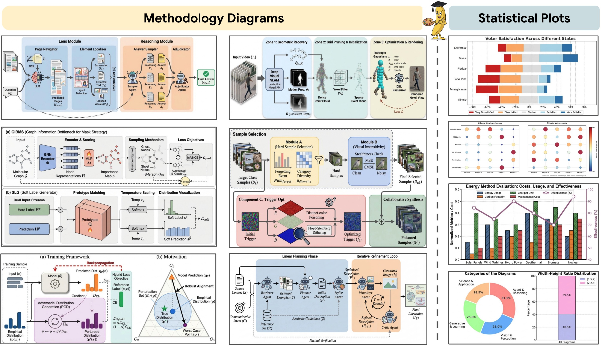

# PaperBanana-CN 学术配图助手 🍌

从论文方法章节与图注生成学术配图，支持参考检索、规划、风格优化、图像生成和多轮评审。

基于 [PaperBanana-CN](https://github.com/Mylszd/PaperBanana-CN) 和原项目 [PaperBanana](https://github.com/dwzhu-pku/PaperBanana) 改进，保留 Apache-2.0 许可证及原始作者署名。



## 这版增加了什么

- **文本与图像独立配置**：两组连接分别设置平台、Base URL、模型名称和 API Key，可跨平台组合。
- **更多平台**：Omgt / New API、OpenAI、OpenRouter、Google Gemini、Evolink、硅基流动、阿里云百炼、DeepSeek 文本模型及自定义 OpenAI 兼容平台。
- **可靠生成**：单个候选失败不影响其他结果；每个候选完成后保存；失败项单独重试；支持取消与历史结果恢复。
- **风格优化容错**：文本请求遇到断线、超时或空正文时按上限重试；风格优化仍遇到临时故障或文本长度限制时，显示提示并沿用已完成的规划继续生成。密钥、权限、参数及安全规则错误会停止该候选。
- **控制消耗**：同一输入的自动检索共享结果，空参考库跳过请求；设置并发数、生图请求上限及单次文本输出 token 上限。
- **中文出图设置**：自动、中文、英文或中英双语标签，支持用户术语表。
- **论文格式下载**：配图保留无损 PNG；启用统计图代码绘制后，可导出 PNG、SVG、PDF。
- **启动与部署**：端口占用时选择空闲端口，不终止其他应用；依赖未变化时跳过安装；Docker 镜像排除本地密钥和结果。

## 快速开始

先下载本仓库的 ZIP 并解压，或使用 Git 获取源码：

```bash
git clone https://github.com/Rayz3rk/mypaperbanana.git
cd mypaperbanana
```

### 1. 启动

Windows 双击 `win-start.bat`；macOS 双击 `mac-start.command`。建议预先安装 Python 3.12，最低支持 Python 3.10。

首次运行会创建 `.venv` 并安装依赖。启动脚本默认使用 `127.0.0.1:8501`；端口被占用时自动尝试 8502–8599，并打开实际选中的地址。关闭终端或按 `Ctrl+C` 停止服务。

依赖安装失败会停止启动并显示错误。后续仅在 `requirements.txt` 或 Python 主次版本变化时重新安装；需强制重装时，删除 `.venv/.requirements.sha256` 后再启动。

macOS 首次打开下载的脚本可能需要在访达中右键选择“打开”，或在系统设置的“隐私与安全性”中允许打开。

### 2. 分别配置两组模型

打开“**模型连接**”标签页。两组连接互相独立，均填写各自的 API Key：

| 连接 | 用途 | 应选择的模型能力 |
| --- | --- | --- |
| 文本模型连接 | 参考筛选、规划、风格化、评审 | 使用参考图片或评审时，需要支持图像输入的多模态模型 |
| 图像模型连接 | 生图、修改图片 | 需要支持所选图像接口协议的图像模型 |

可点击“**读取模型列表 / 检查连接**”，再选择模型，或手动填写账号实际可用的模型名称。此按钮只读取模型列表，不调用生成接口；模型列表可读不代表该模型一定支持图片编辑或所有尺寸。

密钥默认只在当前会话中使用。只有点击“**保存连接到本机（包含密钥）**”才写入 `configs/connections.local.yaml`；该文件已加入 Git 和 Docker 忽略列表。原有 `configs/model_config.yaml` 继续兼容，应用不会改写它。

### 3. 接入 https://newapi.omgteam.me/

文本与图像连接都可以选择“**Omgt / New API**”：

- Base URL：`https://newapi.omgteam.me/v1`
- API Key：分别填写两组连接要使用的 Key，可以不同。
- 模型名称：分别从对应 Key 的模型列表选择。
- 图像接口协议：默认选择 **OpenAI Images**；若对应渠道要求聊天返图或 Gemini 原生接口，再选择匹配的协议。

例如：文本连接使用 Omgt 的多模态模型与 Key A，图像连接使用另一家平台的图像模型与 Key B，也可以反过来配置。

完整配置示例和接口选择说明见 [模型接入指南](docs/model-connections.md)。

### 4. 生成或精修

在“**生成候选方案**”粘贴方法章节和图注，设置候选数量、并发数、0–5 轮评审和图中文字语言，再开始生成。

在“**图片精修 / 文字生图**”中，可上传参考图片并输入修改要求，也可以不上传图片、直接输入描述生成新图。参考图片编辑能力由所选模型及渠道决定。

任务运行期间会显示阶段和已完成数量；可取消后续请求，或查看已完成候选。服务端已受理的请求可能仍会结算。

## 参考库与检索

参考库放在以下位置；`ref.json` 中的图片路径必须与实际文件对应：

```text
data/PaperBananaBench/
├── diagram/
│   ├── images/
│   └── ref.json
└── plot/
    ├── images/
    └── ref.json
```

数据集来源：[PaperBananaBench](https://huggingface.co/datasets/dwzhu/PaperBananaBench)。未下载或参考库为空时，程序会显示状态并跳过检索，不为“空库”请求模型。

| 检索模式 | 行为 |
| --- | --- |
| `auto` | 主要使用参考图注进行筛选；同一批相同输入共享检索结果 |
| `auto-full` | 加入完整参考正文，输入消耗通常更高 |
| `random` | 随机选择参考，不调用筛选模型，保留候选多样性 |
| `none` | 不使用参考库 |

图注筛选减少的是检索阶段的输入，不等于固定降低总费用，也不保证与完整正文检索效果相同。

## 费用与请求上限

配图的图像请求数量可按下式估算：

```text
候选数 ×（1 张初图 + 实际重绘轮数 + 可选的规划阶段中间图）
```

例如，5 个候选、3 轮评审均需要重绘，通常最多产生 **20 次生图请求**；完整流水线如额外保留规划阶段中间图，还会增加 5 次。评审提前通过时会少于该数量。文本请求、参考图片输入、分辨率、重试及平台计费方式另行影响费用。

“本次生图请求上限”限制当前任务的生图调用次数，**不是人民币预算或最终账单保证**。“单次文本最大输出 tokens”限制单次文本响应长度，不限制全部输入 tokens。统计图代码绘制主要调用文本模型，不按配图的图像请求公式估算。

Evolink 的 `gemini-nano-banana-2.1` 生图描述超过4000 tokens会被拒绝。规划、风格化和评审阶段会要求简洁描述；该渠道提交前再按完整提示词的UTF-8字节数作保守检查（3600字节，包含语言和术语说明）。超出时通过已配置的文本连接语义压缩，最多两次；仍过长则停止，不截断文本、不提交生图。压缩会增加文本请求；字节预算不是模型的精确token计数。

## 历史、重试与下载

- 完成的候选逐个保存在本机 `results/demo/`，单个失败不会丢弃其他成功结果。
- “历史结果”页可载入已保存任务或导入旧版结果 JSON。
- 新版历史记录含输入和参数，可只重试未完成或失败候选；旧版仅有结果数组时可查看下载，不能凭空恢复缺失的输入。
- JSON 和下载 ZIP 不包含模型密钥，但包含论文输入及图片。
- 配图可下载无损 PNG；统计图在启用代码绘制后提供 PNG/SVG/PDF。

统计图的“允许执行生成的绘图代码”默认关闭。启用后在独立子进程执行并限制运行时间；这不是文件访问权限沙箱，应在可信本地环境使用。中文字体会从本机可用字体中选择。

## 手动安装与开发测试

```bash
python -m venv .venv
# macOS / Linux
source .venv/bin/activate
# Windows PowerShell
# .venv\Scripts\Activate.ps1
python -m pip install -r requirements.txt
python -m streamlit run demo.py --server.address 127.0.0.1
```

依赖文件给出了兼容版本范围，不是完整锁文件。开发与离线回归测试：

```bash
python -m pip install -r requirements-dev.txt
python -m pytest tests -q
```

无需在测试中填写真实 API Key。命令行用法和 Docker 部署见 [接入与部署指南](docs/model-connections.md)。

## 致谢

本项目基于 [PaperBanana](https://github.com/dwzhu-pku/PaperBanana) 开源项目改造。原始论文：

```text
Zhu, Dawei, et al. "PaperBanana: Automating Academic Illustration for AI Scientists."
arXiv preprint arXiv:2601.23265 (2026).
```

许可证：[Apache-2.0](LICENSE)。本项目与上述 API 平台无商业关联。
